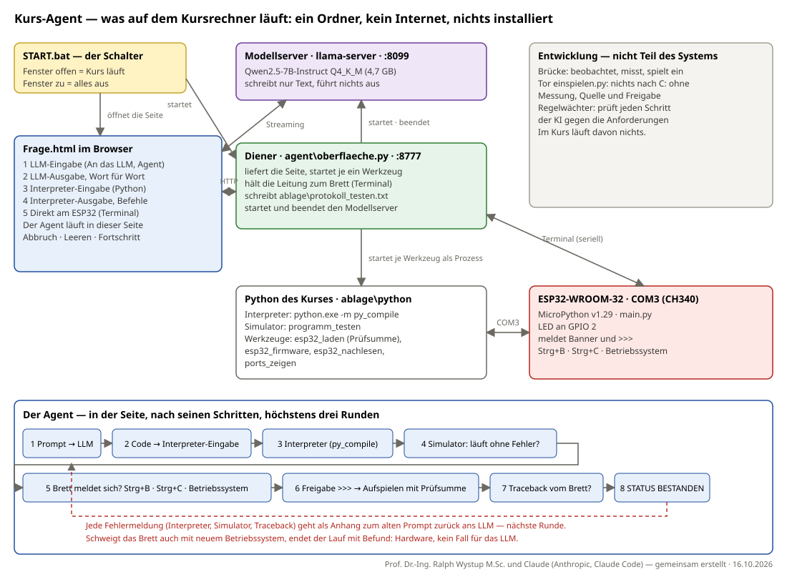

# Kurs-Agent — eine lokale KI schreibt, prüft und flasht Programme (ESP32 als Beispiel)

**Autoren:** Prof. Dr.-Ing. Ralph Wystup M.Sc. und Claude (Anthropic, Claude Code) — gemeinsam erstellt · Fassung 2.0 vom 16.10.2026

**Seite:** https://ralphwystup.github.io/Kurs-Agent-Lokale-KI-schreibt-prueft-und-flasht-Programme-ESP32-als-Beispiel/ —
System, grafische Übersicht, Installation Schritt für Schritt, die zehn Anforderungen, die Kursseite im Bild.

Ein Kurspaket in **einem einzigen Ordner**: Schülerinnen und Schüler programmieren einen ESP32 in MicroPython mit einem
Sprachmodell als Helfer, das auf dem Kursrechner läuft. Kein Internet, kein Konto, keine Installation — `START.bat` löst alles aus.
Ein Agent in der Seite führt den Auftrag selbst durch die Kette: Sprachmodell → Interpreter → Simulator → meldet sich das Brett?
→ Aufspielen mit Prüfsumme → läuft es? Jede Fehlermeldung geht als Anhang zurück an das Modell, höchstens drei Runden.

## Neu in Fassung 2.0 (16. Oktober 2026) — der Neuanfang

Fassung 3.1 vom 5. Oktober (Gesprächsoberfläche, feste Anfragen, Coder-3B, elf Werkzeuge) ist vollständig ersetzt. Was jetzt anders ist:

- **Ein Ordner, ein Schalter.** `START.bat` richtet ein, startet Diener, Modellserver und Browser und bleibt als Fenster offen; Fenster zu = alles aus. Nichts wird installiert; Fehlendes kommt aus dem Paket, auch der USB-Treiber.
- **Fünf Fenster statt eines Gesprächs.** LLM-Eingabe, LLM-Ausgabe, Interpreter-Eingabe, Interpreter-Ausgabe, Direkt am ESP32. Jedes zeigt nur die rohe Ausgabe seiner Quelle — der Interpreter spricht selbst, das Brett spricht selbst.
- **Der Agent nach den Schritten des Auftraggebers.** Prompt → Code → Interpreter → Simulator → meldet sich das Brett (Strg+B, Strg+C, Betriebssystem)? → Freigabe `>>>` → Aufspielen mit Prüfsumme → Traceback? Fehlermeldungen gehen als Anhang zurück ans LLM, drei Runden. Kein Maßstab mehr: gemessen wird „läuft".
- **Modell:** Qwen2.5-7B-Instruct statt Coder-3B; Übersetzen mit `py_compile` des Kurs-Pythons; Simulator mit nachgebautem `machine`.
- **Anwendersicher:** Anschluss wird beim Start erkannt; Fortschrittsbalken; Agentenschritte mit Uhrzeit; alle Knöpfe grau, solange der Agent läuft; Installationsanleitung mit Fehlerfällen auf der Seite.
- **Die zehn Anforderungen** (vorher „Gebote") als Reiter und als Maßstab für die Entwicklung: Tor `einspielen.py` vor dem Kursordner, `regelwaechter.py` vor jedem Schritt der KI, `ANFORDERUNGEN.md` mit jedem Satz des Auftraggebers.
- **Gemessen am 16.10.2026:** Einrichtung 12/12, Schalter 9/9, Diener 7/7, Simulator 10/10, sechs Agentenläufe in Runde 1 bestanden. Nicht gemessen: der leere Rechner, der Weg über das Betriebssystem, die Rückschleife am Brett.

## All-in-one — wer bekommt was

| | bekommt | braucht Internet |
|:--|:--|:--|
| **Der Nutzer im Kurs** | den gefüllten Ordner `Kurs_Agent` (rund 5 GB) auf einem Stick oder als Kopie — alles drin: Python, Modellserver, Sprachmodell, Firmware, USB-Treiber, Werkzeuge, Seite | **nein**, nie |
| **Dieses Repositorium** | die Quelltexte, die Anleitung, das Prüfmaterial und `hole_paket.py` | — |
| **Der Dozent, einmal** | füllt den Ordner mit `hole_paket.py --modell 7b` aus den Originalquellen (Python, Räder, llama.cpp, MicroPython, Treiber, Modell) und kopiert ihn auf den Stick | ja, einmal, auf dem Vorbereitungsrechner |

Die 5 GB passen nicht in ein Git-Repositorium (Grenze 100 MB je Datei, das Modell hat 4,7 GB). Darum ist die Auslieferung an den
Nutzer der Ordner, nicht dieser Klon.

## Für den Nutzer: Ordner kopieren, START.bat

1. Ordner `Kurs_Agent` vom Stick auf das Laufwerk kopieren, zum Beispiel nach `C:\Kurs_Agent`. Der Ort ist frei.
2. ESP32 per USB anschließen.
3. `START.bat` doppelklicken. Das Fenster „Kurs-Agent" bleibt offen, solange gearbeitet wird; es ist der Schalter.
   Die Einrichtung (`agent\einrichten.py`) sieht zwölf Punkte nach und richtet **nur das Fehlende aus dem Paket** ein — ohne Netz:
   das Python des Kurses aus `paket\python_vorlage` (die mitgelieferte Vorlage ist vollständig: pip, pyserial, mpremote, esptool, tkinter —
   gemessen am 16.10.2026: erster Start ohne `ablage\python` → 12 von 12), zur Not pip aus `paket\get-pip.py` und Pakete als Räder aus `paket\pakete`,
   tkinter aus dem Archiv, den CH340-Treiber aus `paket\treiber` (Windows-Bordmittel pnputil; verweigert Windows das mangels Rechten,
   einmal „Als Administrator ausführen"). Jeder Punkt wird davor und danach gemessen und angezeigt. Dann startet der Diener, der Diener
   startet den Modellserver und öffnet die Seite im Browser unter `http://127.0.0.1:8777`.
4. Fenster „Kurs-Agent" schließen = Kurs aus (Leitung zu, Modellserver beendet, Diener beendet). Ordner löschen = alles entfernt.

Die ausführliche Anleitung mit allen Fehlerfällen steht auf der Seite oben unter **Installation** und im Kurs selbst im Reiter Installation.

## Für den Dozenten: das Paket füllen

    git clone https://github.com/RalphWystup/Kurs-Agent-Lokale-KI-schreibt-prueft-und-flasht-Programme-ESP32-als-Beispiel.git Kurs_Agent
    cd Kurs_Agent
    python hole_paket.py --modell 7b

`hole_paket.py` holt aus den Originalquellen (siehe `LIZENZEN.md`) nach `paket\`: das eingebettete Python 3.12 als `python_vorlage`,
`get-pip.py`, die Windows-Räder, llama.cpp (`llama\llama-server.exe`), die MicroPython-Firmware ESP32_GENERIC, die WCH-Treiber und das
Modell Qwen2.5-7B-Instruct Q4_K_M nach `paket\modell` (gewählt in `paket\modell\GEWAEHLT.txt`). Liegt ein gefülltes Paket nebenan oder
auf einem Stick, nimmt es die Dateien von dort und holt nichts aus dem Netz. Danach einmal `START.bat` auf dem Vorbereitungsrechner,
dann den ganzen Ordner auf den Stick.

## Das Paket von Hand füllen — jeder Bestandteil mit Link

`hole_paket.py` tut das automatisch. Wer es von Hand macht (oder nachsehen will, was geholt wird), braucht genau diese Dateien an genau
diesen Orten. Danach ist der Ordner all-in-one: kopieren, Stick, `START.bat` — ohne Internet.

| Bestandteil | Quelle | Datei | Ziel im Ordner |
|:--|:--|:--|:--|
| Python 3.12.10, eingebettet (Windows 64 Bit) | https://www.python.org/ftp/python/3.12.10/python-3.12.10-embed-amd64.zip | python-3.12.10-embed-amd64.zip (11 MB) | `paket\ — und entpackt nach paket\python_vorlage\` |
| pip (Bootstrap) | https://bootstrap.pypa.io/get-pip.py | get-pip.py (2,2 MB) | `paket\get-pip.py` |
| Räder: pyserial, mpremote, esptool mit Abhängigkeiten | https://pypi.org/ — auf einem Rechner mit Internet: `pip download pyserial mpremote esptool -d paket\pakete --platform win_amd64 --python-version 3.12 --only-binary=:all:` | *.whl | `paket\pakete\` |
| tkinter für das eingebettete Python | liegt im Repositorium | tkinter-8.6.13-py3.12-win-amd64.zip (3 MB) + .sha256 | `paket\ (schon da)` |
| llama.cpp, Windows-Build (CPU) | https://github.com/ggml-org/llama.cpp/releases — Datei `llama-bNNNN-bin-win-cpu-x64.zip` | Archiv (etwa 20 MB), entpackt: llama-server.exe und DLLs | `paket\llama\` |
| optional: signierter llama-server (wenn Smart App Control den Build sperrt) | https://github.com/ollama/ollama/releases — `ollama-windows-amd64.zip`, darin `lib\ollama\` | llama-server.exe und DLLs | `paket\llama_signiert\` |
| MicroPython-Firmware ESP32_GENERIC v1.29.0 | https://micropython.org/resources/firmware/ESP32_GENERIC-20260824-v1.29.0.bin | ESP32_GENERIC-20260824-v1.29.0.bin (1,8 MB) | `paket\firmware\` |
| USB-Treiber CH340/CH341 (WCH) | https://www.wch-ic.com/downloads/CH341SER_ZIP.html | CH341SER.ZIP (entpacken, .inf bleibt im Ordner) | `paket\treiber\` |
| Sprachmodell Qwen2.5-7B-Instruct, Q4_K_M (ab 16 GB RAM) | https://huggingface.co/bartowski/Qwen2.5-7B-Instruct-GGUF/resolve/main/Qwen2.5-7B-Instruct-Q4_K_M.gguf | Qwen2.5-7B-Instruct-Q4_K_M.gguf (4,68 GB) | `paket\modell\ — Dateiname steht in paket\modell\GEWAEHLT.txt` |
| kleiner: Qwen2.5-3B-Instruct, Q4_K_M (ab 8 GB RAM) | https://huggingface.co/bartowski/Qwen2.5-3B-Instruct-GGUF/resolve/main/Qwen2.5-3B-Instruct-Q4_K_M.gguf | Qwen2.5-3B-Instruct-Q4_K_M.gguf (1,93 GB) | `paket\modell\ — dann GEWAEHLT.txt auf diesen Namen ändern` |

Reihenfolge danach: `START.bat` einmal auf dem Vorbereitungsrechner starten (die Einrichtung kopiert das Python nach `ablage\python`,
richtet pip, Räder und tkinter ein und meldet 12 von 12), dann den **ganzen Ordner** auf den Stick. Auf dem Kursrechner: Ordner kopieren, `START.bat`.
Die Einrichtung dort sieht wieder alles nach und richtet nur ein, was fehlt — aus dem Paket, nie aus dem Netz.

## Die Kursseite (Frage.html)

Fünf Fenster, von oben nach unten: **1 LLM-Eingabe** mit An das LLM / Agent / Abbruch / Leeren · **2 LLM-Ausgabe** (Wort für Wort) ·
**3 Interpreter-Eingabe** (Python für den ESP32, vorgefertigte Testprogramme zum Ändern) · **4 Interpreter-Ausgabe** mit den zwei
Befehlen „Betriebssystem auf den ESP32" und „Programm auf den ESP32" (übersetzt zuerst) · **5 Direkt am ESP32** mit Fortschrittsbalken
und Terminal. Jedes Fenster zeigt nur die rohe Ausgabe seiner Quelle — der Interpreter sagt, was der Interpreter sagt, das Brett, was das
Brett sagt. Dazu die Reiter Protokoll (live), System, Ablauf (Übersicht), Installation, Anforderungen.

## Der Agent — die Schritte des Auftraggebers

Prompt ans LLM → reiner Python-Code in die Interpreter-Eingabe → der Interpreter zeigt sein Ergebnis → Simulator: läuft es ohne Fehler?
→ ist der ESP32 angeschlossen und meldet er sich (Strg+B; läuft das alte Programm noch: Strg+C; sonst Betriebssystem aufspielen)?
→ Freigabe ist `>>>` → das übersetzte Programm aufspielen (SHA-256 vom Brett) und starten → meldet das Brett einen Traceback?
Jede Fehlermeldung geht als Anhang zum alten Prompt zurück ans LLM. Während der Agent läuft, ist nur „Abbruch" frei; jeder Schritt steht
mit Uhrzeit unter den Knöpfen und in `ablage\protokoll_testen.txt`. Gemessen wird „läuft", nicht „richtig" — es gibt keinen Maßstab.

## Die zehn Anforderungen (sein Wort, 15.10.2026)

1. Wir vermuten nie etwas! Wir rechnen und prüfen immer — bis ins kleinste Detail.
2. Der manuelle Test muss zu 100 % funktionieren!
3. Das System muss autark funktionieren, ohne Internet; die KI beobachtet, analysiert, verbessert — ist aber nie Teil des Systems!
4. Wir bescheißen nicht! Kein Fake, keine fertigen Programme aus der Hinterhand.
5. Es wird grundehrlich geprüft, ob es Fehler gibt; sie werden ohne Ausnahme benannt und behoben.
6. Alles wird gegen diese Anforderungen immer bis ins Detail geprüft!
7. Nichts dem Zufall: zuerst Literatur und Git, erst dann eigene Ansätze.
8. Alles muss über eine Datei auf einen jungfräulichen Rechner übergeben werden können.
9. Vor dem Installieren nachsehen, ob es das schon gibt; sonst alles mitführen — kein Internet!
10. Wir suchen immer eine Lösung — geht nicht gibt es nicht!

## Was drin ist

| Datei / Ordner | Inhalt |
|:--|:--|
| `Frage.html` | die Kursseite: fünf Fenster, der Agent, die Reiter Protokoll, System, Ablauf, Installation, Anforderungen |
| `START.bat` | der Schalter: Einrichtung, Diener im Vordergrund, Modellserver, Browser; Fenster zu = alles aus |
| `agent/einrichten.py` | nachsehen, dann nur das Fehlende aus dem Paket einrichten — ohne Netz |
| `agent/oberflaeche.py` | der Diener auf 127.0.0.1:8777: Seite, Interpreter (py_compile), Werkzeuge als Prozesse, Leitung zum Brett, Protokoll, Modellserver |
| `agent/modell.py`, `pfade.py`, `sauber.py`, `waechter.py` | Modellserver starten/prüfen, Pfade und Umgebung des Kurses (nichts außerhalb des Ordners), Aufräumen |
| `agent/werkzeuge/` | je eines ein Programm, JSON rein, Text raus: `programm_testen` (Simulator mit nachgebautem `machine`), `esp32_laden` (Aufspielen, SHA-256 vom Brett, Neustart), `esp32_firmware` (MicroPython aufspielen, Banner gemessen), `esp32_nachlesen`, `ports_zeigen`, weitere |
| `testprogramme/` | drei Programme des Auftraggebers (`VON_IHM.txt`), zum Ändern freigegeben |
| `paket/` | hier landet das Gefüllte (nicht im Repositorium); mitgeliefert: tkinter-Archiv, Brett-Tafel `bretter/aktiv.json`, Vorlagen, `modell/GEWAEHLT.txt` |
| `hole_paket.py` | füllt `paket/` einmal aus den Originalquellen — der Vorbereitungsschritt des Dozenten |
| `ANFORDERUNGEN.md` | jeder Satz des Auftraggebers wörtlich, mit Befund und Umsetzung, chronologisch — das Lastenheft dieses Projekts |
| `QUELLEN.md`, `MESSUNG.txt`, `EINGESPIELT.txt` | worauf jeder Baustein fußt; jede Messung mit Ort und Zeit; was wann eingespielt wurde |
| `einspielen.py` | das Tor der Entwicklung: nichts kommt in den Kursordner ohne Messung, Quelle und Freigabe (T1–T5) |
| `regelwaechter.py` | prüft in der Entwicklung jeden Schritt der KI gegen die Anforderungen und Regeln, bevor er läuft (Hook, Selbsttest 26 Fälle) |
| `pruefe_simulator.py`, `pruefe_diener.py`, `pruefe_start.py`, `selbsttest_seite.py` | Prüfstände: Simulator mit feststehenden Ergebnissen (10), Diener (7), Schalter (9), Seite am Brett (16) |
| `index.html`, `bilder/` | die Seite für GitHub Pages, aus der Kursseite erzeugt; Übersicht als SVG, Bildschirmfoto |
| `LIZENZEN.md`, `LICENSE` | fremde Bestandteile mit Quelle und Lizenz; eigener Quelltext MIT |

## Stand und Grenzen — gemessen, nicht behauptet

Gemessen am 16.10.2026 auf einem eingerichteten Windows-11-Rechner (16 GB, ESP32-WROOM-32 an COM3, MicroPython v1.29.0):
Einrichtung 12 von 12 · Schalter 9 von 9 (Fenster zu → Diener nach 5 s weg, Modellserver weg) · Diener 7 von 7 · Simulator 10 von 10 ·
sechs Agentenläufe hintereinander, alle in Runde 1 bestanden (1 s an / 3 s aus, 3 s an / 1 s aus, alle 2 s, jede halbe Sekunde);
dabei lief jedes Mal das vorige Programm noch und der Agent holte sich die Freigabe mit Strg+C. Modell: 37 Token/s lesen, 6,6 Token/s schreiben (CPU).

Nachgestellt: der **erste Start** ohne `ablage\python` (Einrichtung baut das Python aus der Vorlage auf, 12 von 12, Simulator 10 von 10; beim ersten
Versuch fehlten pip-Rad und esptool-Rad — behoben). Nicht gemessen: ein **fremder, leerer Rechner** mit fehlendem Treiber (Anforderung 8, 9), der
Dozentenweg `hole_paket.py` → Einrichtung aus Rädern auf Windows, der Weg über das **Betriebssystem** im Agenten,
die **Rückschleife mit Anhang** am Brett (das Modell hat bisher keinen Fehler gemacht, der sie auslöste). Ohne Maßstab heißt BESTANDEN
„läuft", nicht „richtig": ein fehlerfrei blinkendes Programm mit falschen Zeiten ginge durch. Das 7B antwortet aus seinem Trainingsstand;
Faktenfragen ohne Netz können falsch sein. Die Richtigkeit trägt die Messung, nicht das Modell.

## Wie gearbeitet wurde

Nach den zehn Anforderungen. Jeder Satz des Auftraggebers steht in `ANFORDERUNGEN.md`. In der Entwicklung — nicht im Kurs — prüft das Tor
`einspielen.py` jede Lieferung und der `regelwaechter.py` jeden Schritt der KI; beides ist Prüfmittel und läuft im Kurs nicht. Die
Entwicklungs-KI beobachtete den Kursrechner über eine Brücke, war aber nie Teil des Systems (Anforderung 3).

Lizenz: MIT (`LICENSE`); fremde Bestandteile siehe `LIZENZEN.md`.
